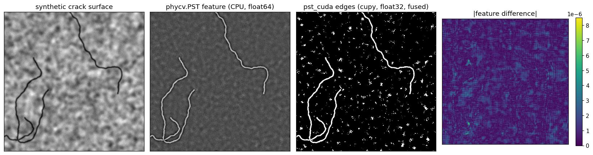
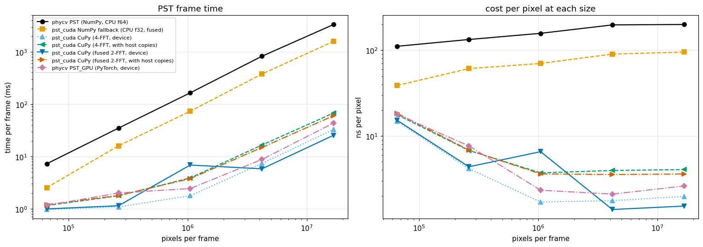

# pst-gpu: Phase Stretch Transform on the GPU

**Edge detection that runs about 130× faster on a GPU, checked pixel by pixel against the original library.**

The **Phase Stretch Transform (PST)** finds edges in an image. It takes the 2-D Fourier transform, gives every spatial frequency a phase delay that grows with frequency, transforms back, and reads the **phase** of the result. Cracks and boundaries are made of high spatial frequencies, so they collect the most phase and light up. PST comes from Bahram Jalali's lab at UCLA and ships in their [PhyCV](https://github.com/JalaliLabUCLA/phycv) library.

This repository is an independent CuPy (CUDA) implementation of PhyCV's PST. It uses the same parameters and produces the same output, and it is tested against the real `phycv` package.



*Left to right: a synthetic concrete surface with three cracks; PhyCV's PST output (CPU, float64); this repo's GPU edge map (float32); the difference between the two analog outputs, at most 8.5 × 10⁻⁶.*

## Results (measured on an RTX 4060 laptop GPU, CUDA 13, CuPy 13.6)

One frame, with filters already built and the image already loaded (the steady state of a video stream). Best of N runs.

| method | 4096 × 4096 frame | cost per pixel (least-squares fit) |
|---|---|---|
| PhyCV `PST` (NumPy, CPU, float64) | 3.34 s | 201 ns |
| PhyCV `PST_GPU` (PyTorch, GPU) | 43.8 ms | 2.6 ns |
| **this repo, GPU (fused, 2 FFTs)** | **25.5 ms (131×)** | **1.4 ns** |
| this repo, GPU, including the copy to and from the GPU | 60.4 ms (55×) | 3.6 ns |

- **Speed varies between runs.** An earlier run measured 138× at the same size. Small images are limited by a fixed ~1 ms per-frame GPU overhead, and in that range PhyCV's PyTorch version is sometimes faster. The 1024² point of the fused path is an outlier in this run (6.9 ms, against 2.7 ms in the earlier run).
- **Accuracy:** in float32, the GPU output differs from PhyCV's float64 output by at most 2.7 × 10⁻⁵ on a 0–1 scale. The binary edge map differs only at pixels that sit exactly on a threshold. In float64 the difference is 3.7 × 10⁻¹⁴, which is round-off.



## What is new here

PhyCV already has a GPU version (`PST_GPU`, built on PyTorch), so this is not the first GPU PST. It adds three things:

1. **Half the FFTs.** PhyCV low-pass filters the image, takes the real part, then immediately Fourier-transforms it again. For any array, FFT(Re *y*)[*k*] = ½(*Y*[*k*] + conj *Y*[−*k*]), so the inverse/forward FFT pair can be skipped exactly. That takes a frame from 4 FFTs to 2. The identity is checked symbolically in SymPy and numerically in the tests.
2. **Filters built once.** Both frequency-domain filters are cached, so a video stream pays for them on the first frame only. PhyCV rebuilds the low-pass filter on every call.
3. **Same code on a CPU.** If CuPy or a GPU is missing, the identical code runs on NumPy.

## How it relates to optical phase recovery

PST is the same three steps as fiber dispersion, H(ν) = exp(iπDν²): FFT, multiply by a phase, inverse FFT. My other project, [Dispersion-Assisted-GS-Phase-Recovery](https://github.com/ColinsCoding/Dispersion-Assisted-GS-Phase-Recovery), uses that step to *recover* a hidden phase from light. PST uses it to *inject* a phase and read edges out.

## Files

| file | what it does |
|---|---|
| `pst_cuda.py` | the GPU PST (`PSTCuda`, same methods as PhyCV's `PST`), the synthetic crack-image generator, and the benchmark |
| `tests/test_pst_cuda.py` | 22 tests: agreement with PhyCV on several image sizes (odd and non-square too), the 2-FFT identity, the filter cache, input validation |
| `notebooks/pst_cuda.ipynb` | the full write-up: the math (SymPy), accuracy tables, the benchmark and the least-squares fit |
| `scripts/build_pst_cuda_nb.py` | builds the notebook (edit this, not the notebook) |

## Run it

```bash
pip install -r requirements.txt
python -m pytest -q
python pst_cuda.py
```

`python pst_cuda.py` compares the GPU result with PhyCV on one 512 × 512 image. Install the CuPy build that matches your CUDA version (for example `cupy-cuda12x`). Without CuPy the code falls back to NumPy, and the GPU tests are skipped.

## Limits

- Timings are from one laptop GPU and one CPU. They change with clocks, temperature and background load.
- Best-of-N timing shows the optimistic steady state, not the average or the worst case.
- The test images are synthetic. Real concrete or pavement photographs have not been tested yet.
- Color input is converted with RGB weights. PhyCV assumes OpenCV's BGR order, so compare with grayscale images.

## References

Written from memory; check them before citing.

[1] M. H. Asghari and B. Jalali, "Edge detection in digital images using dispersive phase stretch transform," *Int. J. Biomed. Imaging*, vol. 2015, Art. no. 687819, 2015.

[2] Y. Zhou, C. MacPhee, M. Suthar, and B. Jalali, "PhyCV: The first physics-inspired computer vision library," *arXiv:2301.12531*, 2023.

[3] R. Okuta, Y. Unno, D. Nishino, S. Hido, and C. Loomis, "CuPy: A NumPy-compatible library for NVIDIA GPU calculations," in *Proc. Workshop on Machine Learning Systems (LearningSys), NeurIPS*, 2017.

## License

MIT License, copyright (c) 2026 Colin Casey. See [`LICENSE`](LICENSE). PhyCV is a separate project by the Jalali Lab with its own license; this repository does not include its code, and uses it only as the reference in tests and benchmarks.
